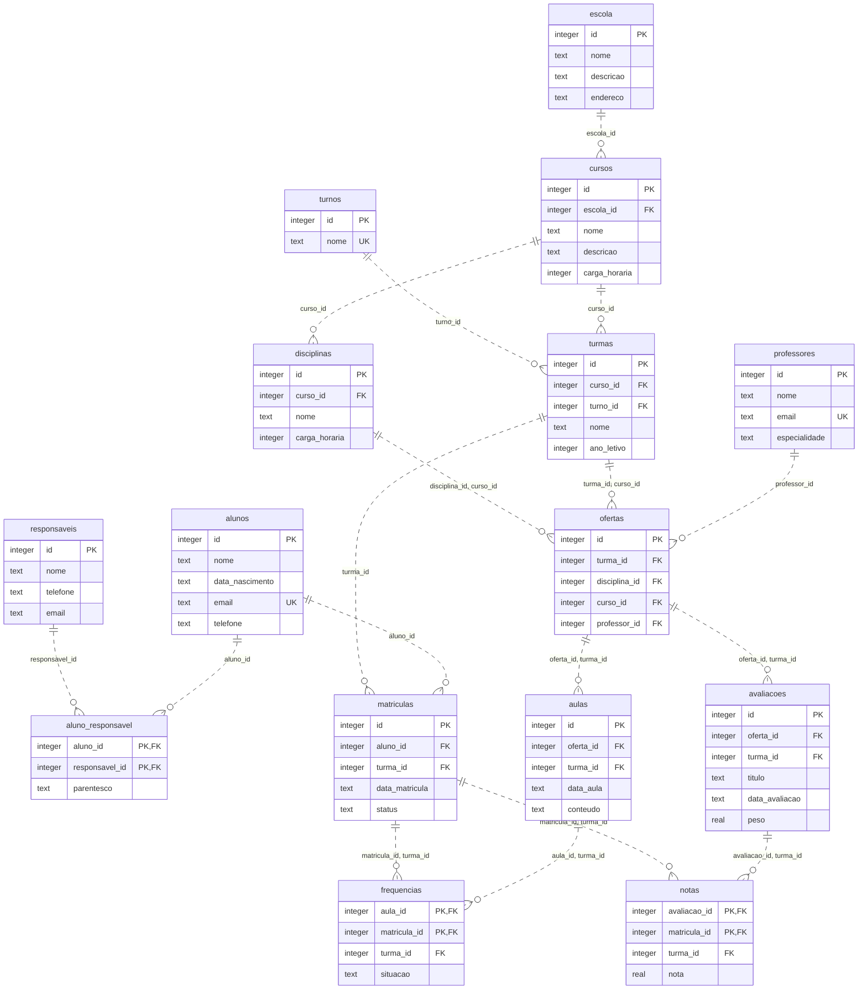

# Diagrama do banco da escola

Abra a visualizacao Markdown deste arquivo (Ctrl+Shift+V no VS Code).
A renderizacao do desenho requer suporte a Mermaid no visualizador.
O arquivo diagrama.mmd contem o mesmo desenho em formato Mermaid.

## Como ler

- Cada caixa representa uma tabela; dentro dela estao todos os campos.
- PK: chave primaria. Se varios campos aparecem como PK, juntos formam uma chave composta.
- FK: campo participante de uma chave estrangeira, simples ou composta.
- UK: campo com UNIQUE individual. As combinacoes UNIQUE estao listadas abaixo.
- `||` significa exatamente um registro do lado da tabela referenciada.
- `o{` significa zero ou muitos registros do lado da tabela que guarda a FK.
- Linhas pontilhadas representam relacionamentos; o rotulo mostra os campos da FK.
- Uma ligacao rotulada com dois campos representa UMA FK composta, validando o par inteiro.

## Observacao sobre o script atual

Na tabela aulas, a linha de conteudo recebeu um trecho de comentario deslocado
(`ante que ...`). Isso impede executar o script como esta. Para desenhar o modelo,
foi considerada a declaracao `conteudo TEXT NOT NULL,`. O script original foi preservado.

## Todas as tabelas e ligacoes

## Mapa exato das FKs

Cada linha desta tabela corresponde a UMA restricao. Quando ha duas colunas,
a verificacao exige que a combinacao exista na mesma linha da tabela de destino.
Nao existe uma FK direta para turmas ou cursos apenas porque turma_id ou curso_id
participa de uma FK composta: o destino real e o indicado abaixo.

| Tabela que guarda a FK | Campos da FK | Tabela referenciada | Campos referenciados |
|---|---|---|---|
| cursos | escola_id | escola | id |
| disciplinas | curso_id | cursos | id |
| aluno_responsavel | responsavel_id | responsaveis | id |
| aluno_responsavel | aluno_id | alunos | id |
| turmas | turno_id | turnos | id |
| turmas | curso_id | cursos | id |
| matriculas | turma_id | turmas | id |
| matriculas | aluno_id | alunos | id |
| ofertas | disciplina_id, curso_id | disciplinas | id, curso_id |
| ofertas | turma_id, curso_id | turmas | id, curso_id |
| ofertas | professor_id | professores | id |
| aulas | oferta_id, turma_id | ofertas | id, turma_id |
| frequencias | matricula_id, turma_id | matriculas | id, turma_id |
| frequencias | aula_id, turma_id | aulas | id, turma_id |
| avaliacoes | oferta_id, turma_id | ofertas | id, turma_id |
| notas | matricula_id, turma_id | matriculas | id, turma_id |
| notas | avaliacao_id, turma_id | avaliacoes | id, turma_id |

## Combinacoes UNIQUE

Cada linha exige que a combinacao inteira nao se repita.

| Tabela | Campos da mesma restricao UNIQUE |
|---|---|
| turnos | nome |
| cursos | escola_id, nome |
| disciplinas | id, curso_id |
| disciplinas | curso_id, nome |
| professores | email |
| alunos | email |
| turmas | id, curso_id |
| turmas | curso_id, nome, ano_letivo |
| matriculas | id, turma_id |
| matriculas | aluno_id, turma_id |
| ofertas | id, turma_id |
| ofertas | turma_id, disciplina_id |
| aulas | id, turma_id |
| avaliacoes | id, turma_id |

## Caminho para estudar

1. escola -> cursos -> disciplinas: estrutura dos cursos.
2. cursos + turnos -> turmas: organizacao das turmas.
3. alunos + turmas -> matriculas: em qual turma cada aluno esta.
4. alunos + responsaveis -> aluno_responsavel: vinculos familiares.
5. turmas + disciplinas + professores -> ofertas: quem ensina o que e onde.
6. ofertas -> aulas e avaliacoes: encontros e atividades avaliativas.
7. aulas + matriculas -> frequencias: presenca de cada aluno matriculado.
8. avaliacoes + matriculas -> notas: resultado de cada aluno matriculado.

Exemplo de FK composta: ofertas(turma_id, curso_id) aponta para turmas(id, curso_id).
Se turmas possui (id=2, curso_id=20), ofertas pode informar (2,20), mas nao (2,10).
